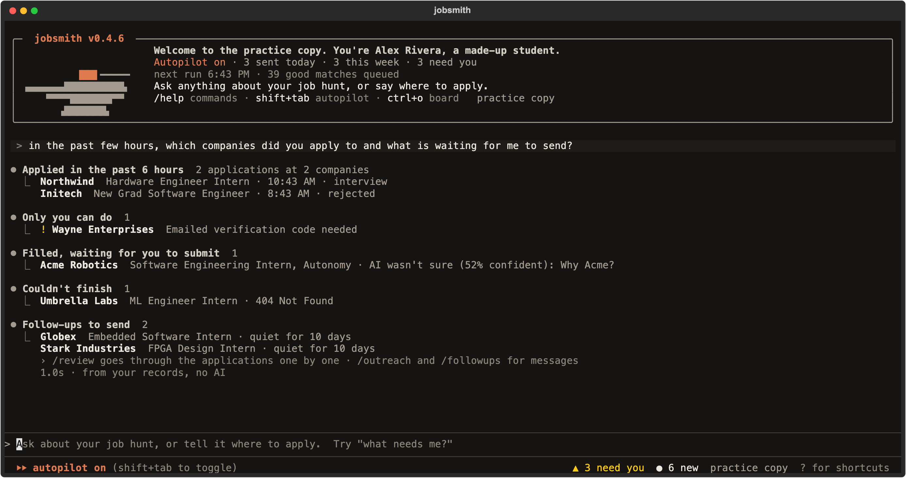
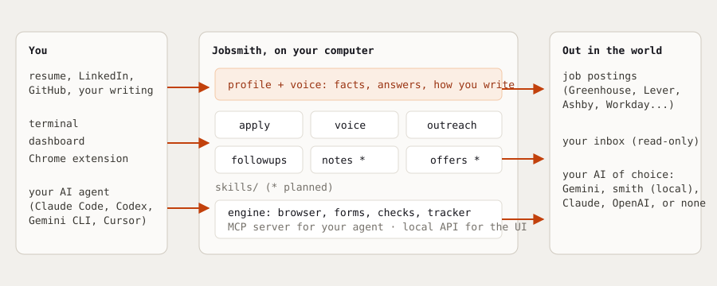

<h1 align="center">Jobsmith</h1>

<p align="center"><b>Open-source tools for the whole job hunt, from finding the role to the offer.</b><br>
Local, free, and built for students applying to software, hardware, data and AI roles.</p>

<p align="center">
  <a href="https://github.com/rawcache/Jobsmith/releases"></a>
  <a href="https://github.com/rawcache/Jobsmith/actions/workflows/ci.yml"></a>
  
  
  <a href="LICENSE"></a>
</p>

<p align="center"><b>Point it at a job list. It applies while you're in class, in your words, and asks you about anything it isn't sure of.</b></p>

<p align="center"></p>

> [!IMPORTANT]
> Get Jobsmith only from this repository or [its website](https://rawcache.github.io/Jobsmith/). Jobsmith runs on your computer: your resume, answers and keys never leave it except as the applications you send.

## Quick start

### Use the terminal

Install with one line. On macOS or Linux, paste into Terminal:

```bash
curl -LsSf https://raw.githubusercontent.com/rawcache/Jobsmith/main/install.sh | sh
```

On Windows, paste into PowerShell:

```powershell
powershell -ExecutionPolicy Bypass -c "irm https://raw.githubusercontent.com/rawcache/Jobsmith/main/install.ps1 | iex"
```

Then run `jobsmith`. The installer says if you need to open a new window first. It needs no git, compiler or admin
rights, and works on Intel and Apple silicon Macs, Linux (x86 and ARM) and Windows (x86 and ARM).

The first run asks what you're applying for and which AI to use, and reads your resume. Then it works like Claude
Code: one prompt, a conversation, and everything a `/command` away.

- **Ask** about your job hunt in plain words: *"in the past few hours, which companies did you apply to, and what's
  waiting for me to send?"* The answer builds up line by line from Jobsmith's own records. It's instant and offline,
  with no AI.
- **Tell it where to apply**: `apply to nvidia hardware internships`, a job link, a GitHub list, or a company's
  Greenhouse, Lever or Ashby board (`jobs.lever.co/palantir`). Boards are read as JSON, and roles too senior for you,
  asking for more experience than you have, or paying under your minimum are left out before a browser opens.
  Applications in progress animate above the prompt.
- **`/review`** goes through what's waiting for you, problems first: approve or edit each answer, then submit.
  **`/matches`**, **`/outreach`**, **`/followups`**, **`/voice`** and **`/settings`** open the same way.
- **Shift+Tab** turns autopilot on or off. **Ctrl+O** shows everything at once. **`?`** lists shortcuts.

`jobsmith --plain` gives a line-by-line prompt instead, and `/web` opens the dashboard.

### Set up your agent

Already use Claude Code, Codex, Gemini CLI or Cursor? Let it be the brain:

```bash
jobsmith skills install            # registers Jobsmith's MCP server and adds its skills to the agents on this computer
```

### Ask your agent

> "What does Jobsmith have waiting for me? Write the open questions in my voice, then apply."

Your agent reads each open question with the posting, your facts and examples of your own writing, and writes the
answer. Jobsmith checks it (every number and claim must come from your facts) before anything is submitted.

### Update Jobsmith

```bash
uv tool upgrade jobsmith           # then reload the extension in chrome://extensions
```

## How Jobsmith works

<p align="center"></p>

Jobsmith is a set of **skills** on one shared engine. The engine reads postings and forms, checks you qualify, fills
the browser, and tracks every application. Each skill is a folder in [`jobsmith/skills/`](jobsmith/skills) with a
`SKILL.md` that people and AI agents both read.

## Skills

| Skill | What it does | Use it |
|---|---|---|
| **[Apply](jobsmith/skills/apply/SKILL.md)** | Applies to roles you qualify for while you're away: fills every form from your resume, submits what it's sure about, holds the rest. The Chrome extension adds a panel on any posting you open yourself: autofill, resume match, who you know, cover letter, and "Write with Jobsmith" on open questions. | `jobsmith` · `/apply` |
| **[Your voice](jobsmith/skills/voice/SKILL.md)** | Learns how you write from your essays, cover letters and approved answers, on your computer. Answers in your own words with no AI at all, steers any AI toward your style, and tells you which stories you're missing. | `jobsmith voice` |
| **[Outreach drafts](jobsmith/skills/outreach/SKILL.md)** | Referral asks and recruiter notes for people you know at each company, from your LinkedIn connections. You send them. | dashboard · agent |
| **[Inbox and follow-ups](jobsmith/skills/followups/SKILL.md)** | Reads replies (Gmail, Outlook / Microsoft 365, IMAP; read-only), enters emailed codes, drafts a follow-up when a company goes quiet. | dashboard · agent |
| [Interview notes](jobsmith/skills/interview-notes/SKILL.md) | Planned: notes, questions asked and a thank-you draft, transcribed locally, with everyone's consent. | |
| [Interview prep](jobsmith/skills/prep/SKILL.md) | Planned: likely questions for a role and practice answers from your own stories. | |
| [Offers](jobsmith/skills/offers/SKILL.md) | Planned: offers side by side and negotiation talking points. | |

`jobsmith skills` lists them; switch them on or off on the dashboard's Skills page.

## Works with a weak AI, or none

Every answer comes from the first of these that can answer it well. Only the last two need an AI:

| | Source | Needs |
|---|---|---|
| 1 | Your profile (name, school, links, work authorization, demographics) | nothing |
| 2 | Answers you approved before, adapted to this question | nothing |
| 3 | Your own writing that fits the question, with the company and role updated | nothing (the voice skill) |
| 4 | Your AI agent, through the MCP server | your Claude Code, Codex, Gemini CLI or Cursor |
| 5 | The AI you picked: Gemini (free), smith (local), Claude or OpenAI | a key, or smith |

Whatever writes it, the same checks apply before it's sent: claims and numbers must come from your facts, phrases
you never use get flagged, and anything below your confidence setting waits for you. The more of your own writing
you add (`jobsmith voice add essay.md`), the more of it needs no model at all.

**smith** is Jobsmith's own private AI: Qwen3 through [Ollama](https://ollama.com), installed into your user folder
with no admin rights, sized to your memory (8 GB: qwen3:4b, 16 GB: qwen3:8b, 24 GB: qwen3:14b, 32 GB+: qwen3:30b-a3b).
It only runs when you're plugged in (by default), one answer at a time, and unloads when you stop.

## The other ways in

- **Dashboard** at http://127.0.0.1:8765, for when you'd rather click: matches beside the posting, a sortable
  Applications table, the bell, your voice, outreach and follow-ups. Same data as the terminal.
- **Chrome extension** (`jobsmith extension` opens it for you): the panel on job postings described above. It never
  submits by itself. Load it unpacked from `extension/` until it's in the Chrome Web Store.

## What it won't do

- **Make things up.** Every written answer cites facts from your resume and profile.
- **Apply where you don't qualify, unless you say so.** Citizenship or clearance, sponsorship, degree level,
  graduation window and years of experience are checked first; "Apply anyway" overrides it.
- **Send messages for you, type your passwords, create accounts or solve CAPTCHAs.** Those come to you, under the bell.
- **Automate LinkedIn.** It reads your own connections export; it never logs in or messages anyone there.
- **Help you during a live interview.** Notes and practice, yes; hidden answers, no.

You're responsible for what's submitted in your name.

## FAQ

**Does it cost anything?** No. Gemini's free tier covers most days; smith and the voice skill cost nothing at all.

**Which sites?** Greenhouse end to end; Lever, Ashby and most single-page forms filled generically. Workday, iCIMS
and other multi-page sites are filled page by page and stop at review; you sign in yourself.

**Will it heat up my laptop?** Only smith does real work on your machine, and only when you're plugged in. Battery
saver (on by default on battery) fills one application at a time and keeps smith off.

**Can I try it without my real data?** `jobsmith demo` opens a practice copy with a made-up person and jobs. Nothing
in it opens a real site or sends anything.

**A keychain prompt appeared.** If macOS asked for your login keychain password for 'Chromium Safe Storage', click
Deny. Jobsmith's browser doesn't need it, and it never asks for passwords.

## Roadmap

The full plan, with each phase's gate, is in [docs/ROADMAP.md](docs/ROADMAP.md).

- **Phase 0 · Go public** (October 2026): done except the demo video.
- **Phase 1 · Autopilot you can trust** (November 2026): guardrails, posting traps, confirmed submissions, more job sites.
- **Phase 2 · Applications that win** (December 2026): fit evaluation, tailored resumes and reviewed cover letters.
- **Phase 3 · Every job and every reply** (January 2027): Chrome Web Store, job board, more sources, inbox tracking.
- **Phase 4 · Interviews and offers** (February 2027): prep packs, notes, mock interviews, offer comparison.
- **Phase 5 · Platform** (March–April 2027): desktop installer, plugins, other countries, signed releases.

## Contributing

```bash
git clone https://github.com/rawcache/Jobsmith && cd Jobsmith
uv sync && uv run playwright install chromium
uv run jobsmith check            # tests, dashboard build, screenshots of every page
uv run jobsmith dev              # practice copy with live reload while you edit
```

Start from the templates in [`docs/templates/`](docs/templates/), and see [`CONTRIBUTING.md`](CONTRIBUTING.md)
for the steps.

**Add a skill:** copy `docs/templates/skill/` to `jobsmith/skills/<name>/`, fill in its `SKILL.md` (frontmatter:
`name`, `description`, `title`, `status`) and put its code beside it. It appears in `jobsmith skills`, the
dashboard and your agent automatically.
**Support a job site:** copy `docs/templates/adapter.py` to `jobsmith/fill/<site>.py` and test it against a saved
copy of the site's form in `tests/fixtures/`.

| Command | What it does |
|---|---|
| `jobsmith demo` / `--setup` / `stop` | practice copy at :8766 (setup from step 1) |
| `jobsmith setup` (`--web`) | your real setup again, from step 1 |
| `jobsmith check` | tests, build, and a gallery of every page |
| `jobsmith dev` | practice copy with live reload |
| `jobsmith mcp` | the MCP server (agents start it themselves) |
| `jobsmith site` | open the project page |

## Star history

<a href="https://star-history.com/#rawcache/Jobsmith&Date"></a>

## License

MIT. Jobsmith isn't affiliated with Simplify, LinkedIn, or any employer or job site.
