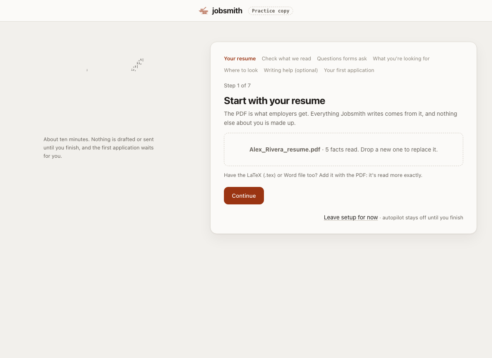
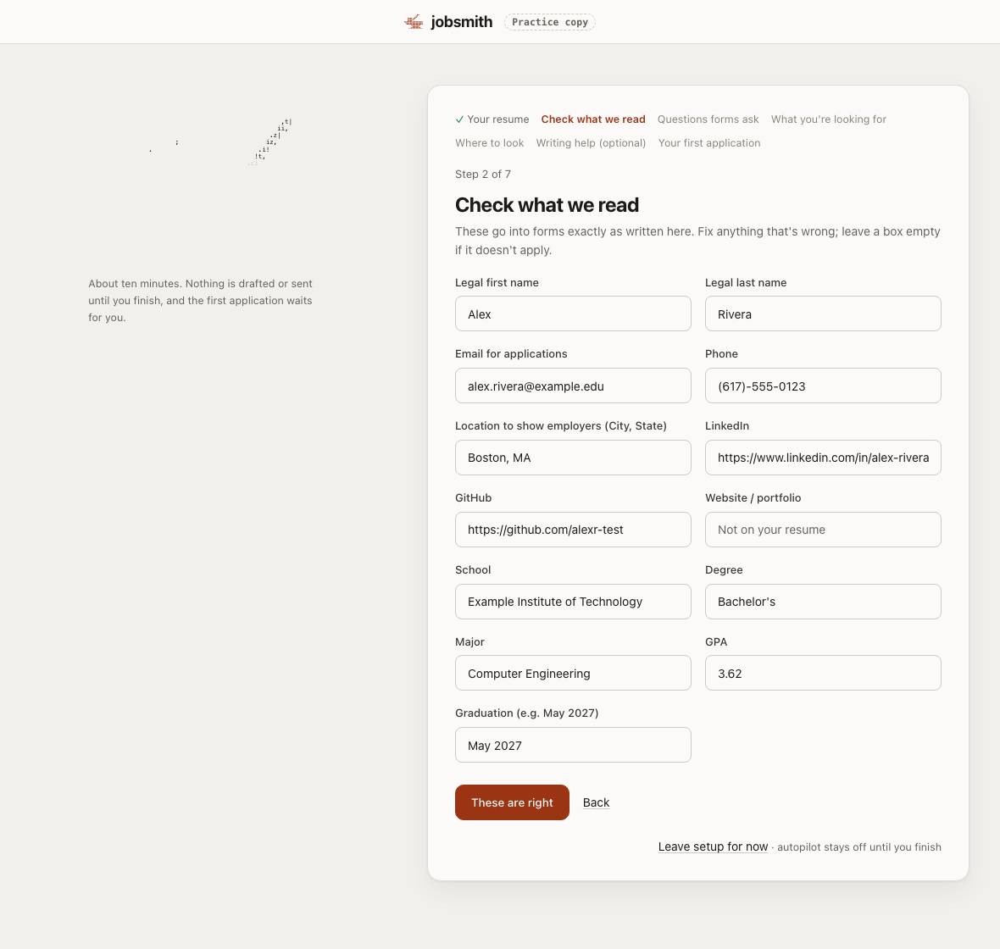
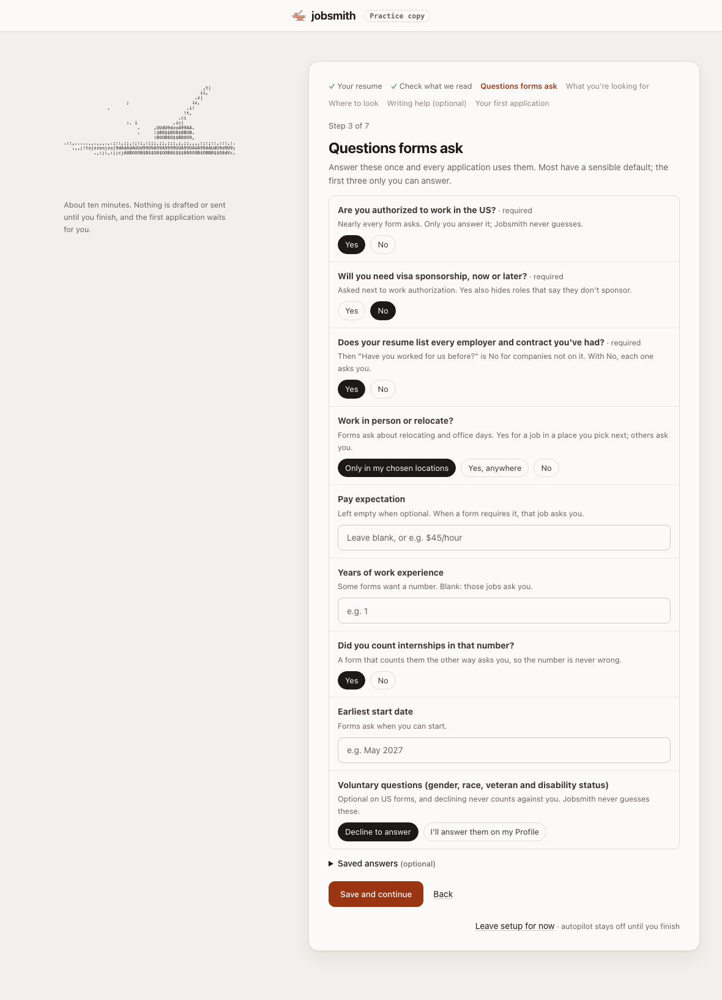
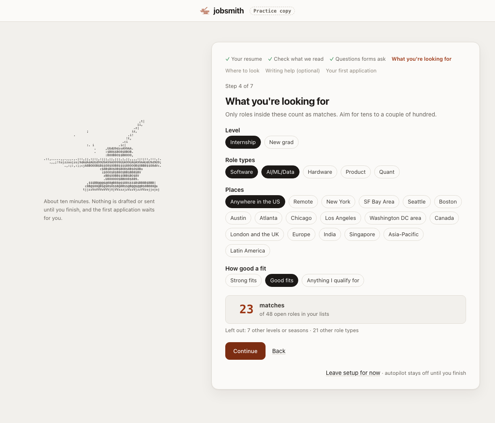
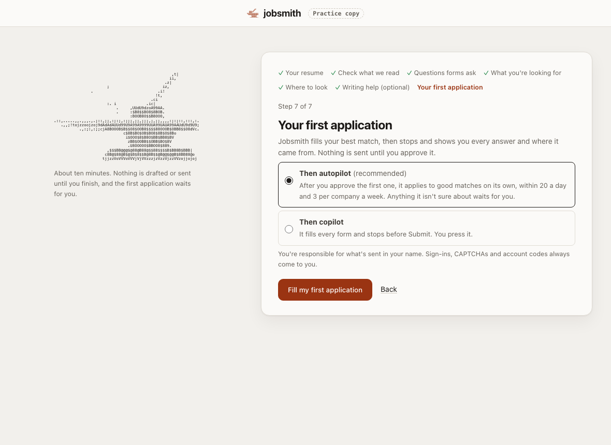
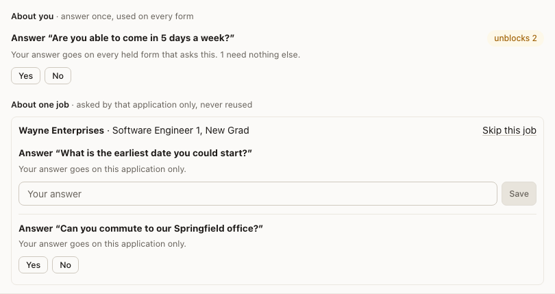

# Getting started

From nothing installed to your first application, in about 15 minutes. You don't need to know how to code.

You need: a Mac, Windows or Linux computer, Google Chrome, and your resume as a PDF.

1. [Install](#1-install)
2. [Set up](#2-set-up-about-ten-minutes)
3. [Approve your first application](#3-approve-your-first-application)
4. [Day to day](#4-day-to-day)
5. [If something goes wrong](#5-if-something-goes-wrong)

To look around before using your own details, run `jobsmith demo` after installing. It opens a practice copy with a
made-up person (Alex Rivera) and made-up jobs. Nothing there opens a real site or sends anything.

## 1. Install

Open **Terminal** (Mac: press Cmd+Space, type "Terminal", press Enter) and paste this line, then press Enter:

```bash
curl -LsSf https://raw.githubusercontent.com/rawcache/Jobsmith/main/install.sh | sh
```

On Windows, open **PowerShell** from the Start menu and paste this instead:

```powershell
powershell -ExecutionPolicy Bypass -c "irm https://raw.githubusercontent.com/rawcache/Jobsmith/main/install.ps1 | iex"
```

It takes about half a minute and asks for no password. When it finishes, type `jobsmith` and press Enter. If it
says the command isn't found, close the window, open a new one and try again.

Jobsmith runs on your computer. There is no account to make and nothing is uploaded to Jobsmith; your resume goes
only to the job sites you apply on and, if you choose one, the AI that helps write answers.

## 2. Set up (about ten minutes)

The first time, Jobsmith asks whether to set up here in the terminal or in your browser. Both ask the same seven
things in the same order; the pictures below are the browser. Nothing is filled in or sent until you finish.

**Your resume.** Choose the PDF. This is the file employers receive, and everything Jobsmith writes comes from it.



**Check what it read.** Your name, email, school and so on, as they will be typed into forms. Fix anything wrong.



**Questions forms ask.** You answer these once and every application uses them. Three have no default, because only
you can answer them: whether you're authorized to work in the US, whether you'll need visa sponsorship, and whether
your resume lists every employer you've had. The rest come filled in with a sensible choice you can change, each
with a line saying why it's asked. The voluntary ones (gender, race, veteran and disability status) start on
"Decline to answer".



**What you're looking for.** Internships or new-grad roles, the kinds of role, and where. The number under the
choices is how many open roles match right now. Aim for tens to a couple of hundred: fewer places or role types
bring it down.



**Where to look.** Tick the job lists to read. You don't paste any addresses.

**Writing help (optional).** Some forms ask open questions ("Why do you want to work here?"). Jobsmith can answer
them from your own saved answers with no AI at all, or you can connect one: Gemini has a free tier, and
`jobsmith smith` sets up a free one that runs on your computer. You can skip this and add one later.

**Your first application.** Pick "autopilot" (it applies on its own after you approve the first one) or "copilot"
(it fills every form and you press Submit). Then press **Fill my first application**.



## 3. Approve your first application

Jobsmith fills your best match and stops. It does not send it. You'll see it under **Needs you** with "approve the
first submission".

Open it and read every answer. Each one says where it came from: your resume, your profile, or your own writing.
If an answer is wrong, change it there. When it all looks right, approve it, and that application is sent.

After that first approval, autopilot sends applications on that job site on its own, up to 20 a day and 3 per
company a week (you can change both in Settings). Its first application on each other job site also stops for your
approval, one at a time.

## 4. Day to day

Leave Jobsmith running and check **Needs you** once or twice a day. It has two parts:



- **About you.** Something several applications are waiting on. Answer it once and every one of them moves on.
- **About one job.** A question only that application asks, shown under its company and role. Answer it, or press
  **Skip this job** if you'd rather not apply. An answer here is used for that job only.

Things Jobsmith never does for you, and brings to you instead: typing a password, making an account, solving a
CAPTCHA, signing in, and answering anything about work authorization, sponsorship or demographics that isn't in
your confirmed profile.

In the terminal, type what you want in plain words ("what's waiting for me?", "apply to nvidia hardware
internships") or a command: `/review` goes through what's waiting, `/status` says what's running, `/web` opens the
dashboard, `/stop` stops everything, and Shift+Tab turns autopilot on or off.

**The Chrome extension is optional.** Autopilot doesn't need it. It adds a Jobsmith panel to job postings you open
yourself, to fill a form you'll submit by hand. Until it's in the Chrome Web Store, add it like this:

1. In the terminal, type `/extension` (or run `jobsmith extension`). It opens Chrome's extensions page and the
   folder to pick.
2. On that page, turn on **Developer mode** (top right).
3. Click **Load unpacked** and choose the folder Jobsmith opened.
4. Click the puzzle piece in Chrome's toolbar and pin Jobsmith.

## 5. If something goes wrong

**macOS asks for your "login keychain" password for "Chromium Safe Storage".** Click **Deny**. Jobsmith's browser
doesn't need it, and Jobsmith never asks for a password. If it keeps appearing, update Jobsmith
(`uv tool upgrade jobsmith`).

**I closed the terminal window.** Jobsmith keeps working in the background. Open Terminal and type `jobsmith` again
to see it; nothing is lost. To stop it completely, type `/stop`.

**"Gemini's free daily limit is used up."** The free tier allows a small number of requests a day. Answers that
need AI wait until it resets (the message says when) and everything that doesn't need AI carries on. To get through
more: write your own answers to the common questions (Settings, "Your saved answers"), set up the free local AI
(`jobsmith smith`), or add a paid key (`/key`).

**My Mac went to sleep and nothing happened overnight.** A sleeping computer can't apply. Keep it plugged in and
awake while Jobsmith works: open a second Terminal window, type `caffeinate -i` and press Enter, and leave that
window open. Press Ctrl+C in it when you want the Mac to sleep normally again. Closing the lid still puts it to
sleep.

**An application "couldn't finish".** It says why next to it, for example "the site didn't answer in time" or "asks
you to sign in before it shows its application form". Open it from Needs you to try again, take over in the Jobsmith
window, or skip it.

**A form looks wrong after Jobsmith filled it.** Nothing is sent without passing its checks, and your first
application on each site waits for you. If you see a mistake, fix the answer where it's shown, and please press
"Report this form" so it gets fixed for everyone.

**Something else.** Ask at [github.com/rawcache/Jobsmith/issues](https://github.com/rawcache/Jobsmith/issues). Never
paste a password, a key or your real resume into an issue.
